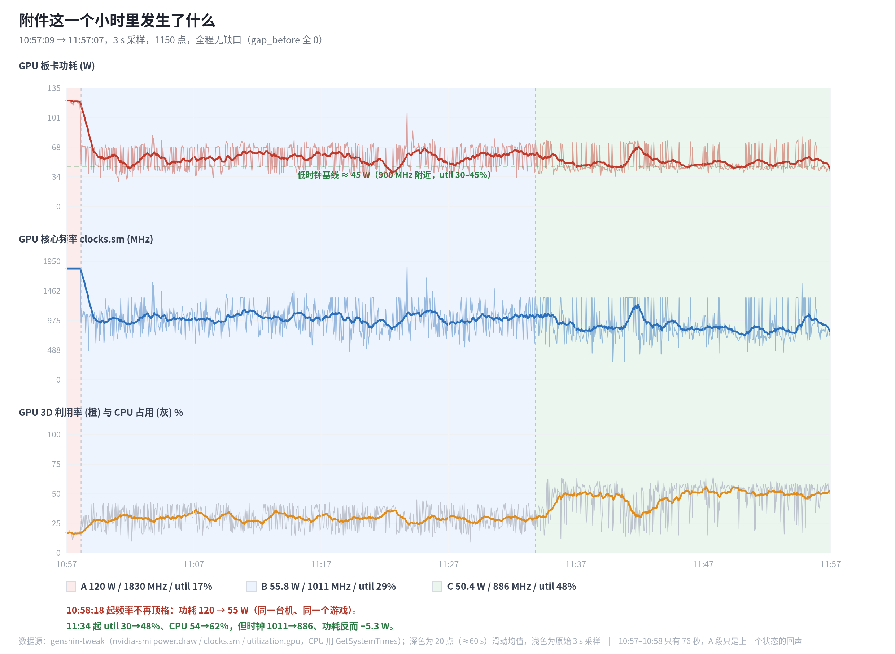
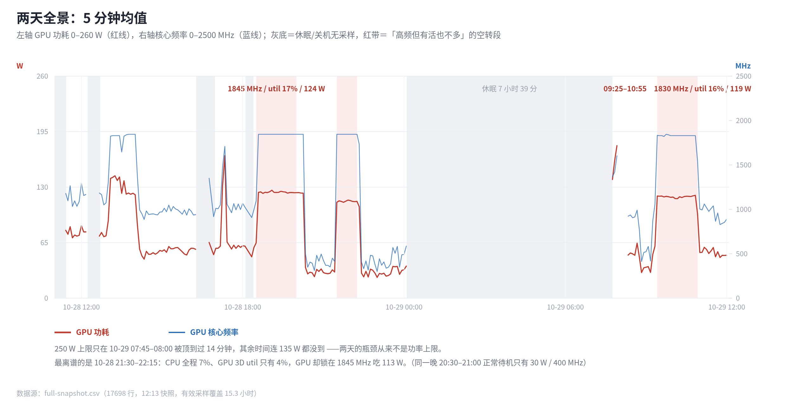
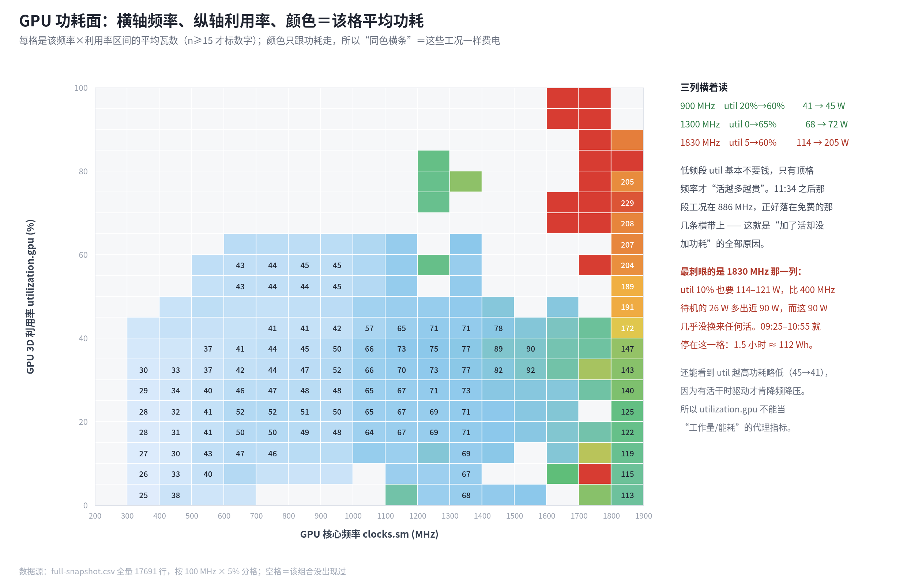

# 2026-10-29 功耗数据复盘：为什么「上了转码，功耗却没变」

> 数据源：`genshin-power-20261029-115709.csv`（附件，10:57:09 → 11:57:07，3 s 采样，1150 点，无缺口）
> 交叉验证：本仓库 `genshin_tweak_power.csv`（正在实时增长）→ 分析时冻结为 `analysis/full-snapshot.csv`（17698 行，10-28 11:26 → 10-29 12:13，有效覆盖 15.3 h）
> 事件：`genshin_tweak_log.csv`（模式切换、休眠/唤醒、断点）

---

## 0. 一句话结论

**GPU 板卡功耗确实几乎没变（还降了 5.3 W），这不是统计出错，而是物理事实 + 采样口径的必然结果：**

1. 那段时间 GPU 的工作频点是 886 MHz，而在这张卡上 **1000 MHz 以下「干活多少」几乎不要钱**（util 从 20% 涨到 60%，功耗只从 41 W 涨到 45 W）；
2. 决定功耗的是**频率**，不是利用率。每 100 MHz ≈ 4.6 W；
3. 但**整机功耗大概率涨了 10–25 W，你的表里完全看不到**——因为 CSV 里没有 CPU 功耗、没有编码器利用率、没有整机功率。转码的主要开销恰好落在这三个空白里。

真正该心疼的不是这段转码，而是 **09:25–10:55 那 90 分钟：1830 MHz、util 16%、119 W**——什么活都没干，白烧了约 **112 Wh**。

---

## 1. 这一个小时的数据长什么样



| 区段 | 时间 | 时长 | 功耗 | 核心频率 | util | CPU | 温度 |
|---|---|---|---|---|---|---|---|
| A | 10:57:09–10:58:18 | 76 s | **120.0 W** | 1830 MHz（顶格不动） | 17% | 51% | 60 ℃ |
| B | 10:58:18–11:34 | 36 min | **55.8 W** | 1011 MHz（600–1350 振荡） | 29% | 54% | 51 ℃ |
| C | 11:34–11:57 | 23 min | **50.4 W** | 886 MHz | **48%** | **63%** | 50 ℃ |

三个可以直接下结论的点：

1. **10:58:18 有一个台阶**：频率从「钉死在 1830 MHz」变成「驱动自己 600–1350 来回调」，功耗 120 → 55 W，温度掉 10 ℃。这不是渐变，是状态切换；`genshin_tweak_log.csv` 在这个时间点没有任何记录，说明**是外部程序状态变了（前台/后台、帧率上限、或别的锁频工具），不是你这个工具干的**。
2. **11:34 之后开始「加活」**：util 29% → 48%（+19 个点），CPU 54% → 63%（+8.8 个点），但时钟自己降了 125 MHz，功耗 **−5.3 W**（t 检验口径：SE ≈ 0.8 W，这个下降是显著的）。
3. **B 段是个假均值**：功耗直方图是双峰的——40 W 档 185 个点、70 W 档 312 个点。真实过程是驱动在 600–900 MHz（≈45 W）和 1050–1350 MHz（≈70 W）两档之间来回跳，"55.8 W" 这个数在现实里从来没出现过。**用均值描述这种数据会骗自己**，看直方图或分档占比才有意义。

---

## 2. 把两天摊开看：贵的是「频率」，不是「活」



| | 覆盖时长 | GPU 电量 | 均值 |
|---|---|---|---|
| 10-28 | 11.08 h | **841 Wh** | 75.9 W |
| 10-29（到 12:13） | 4.19 h | **341 Wh** | 81.4 W |

按工作点切一刀（两天合计 **1182 Wh**，有效采样 15.3 h）：

| 工况 | 时长 | 电量 | 均值 | util |
|---|---|---|---|---|
| 频率 ≥1500 MHz 且 util ≤25% | **4.75 h** | **570 Wh（48%）** | 120 W | 8% |
| 频率 ≥1500 MHz 且 util >25% | 0.90 h | 144 Wh | 161 W | 40% |
| 频率 <1050 MHz | 8.09 h | 327 Wh | 40 W | 21% |

**一半的电量花在「高频、没什么活」上。** 而且这 4.75 小时里 CPU 平均只有 **8.2%**、GPU 3D 平均只有 **8.3%**——机器基本是闲着的，GPU 却挂在 1.8 GHz 一路吃 120 W。两个典型：

- **10-29 09:25–10:55**：1.5 小时，1830 MHz、util 16%、118.8 W，累计 **178 Wh**。同样的活放到 900 MHz 大约 66 Wh → **白烧 112 Wh**，温度还常年 60 ℃（比 50 ℃ 那档高一截，风扇不可能安静）。
- **10-28 21:30–22:15**：CPU 全程 7%（机器基本没人用）、GPU 3D util **4%**，频率却锁在 1845 MHz，吃 **113 W**。同一晚 20:30–21:00 正常待机是 400 MHz / 30 W。**util 4% 与 113 W 同时成立**，这是对「利用率可以当功耗代理」最直接的反驳。

顺便：预设里的 **250 W 上限两天只被顶到过一次**（10-29 07:45–08:00，约 14 分钟，峰值 255.7 W）。其余时间连 135 W 都没有。**你真正有效的旋钮是 `-lgc`（频率），不是 `-pl`（功耗上限）**——这条已经有数据支撑了。

### 最值得先查的一件事：谁把频率钉在 1.8 GHz

那 4.75 小时里 CPU 8%、util 8%，GPU 却锁在 1845 MHz。你的工具在 game 预设下执行的是 `-rgc`（交还驱动），
`-lgc` 的下限是 300 MHz，所以**不是你的工具钉的**。最可能的三个嫌疑：

1. NVIDIA 控制面板 / Profile Inspector 里的电源管理模式被设成「最高性能优先」（见过一次就会被所有 3D 程序继承）；
2. 某个后台程序（浏览器硬件加速、录屏、壁纸引擎、别的调参工具）一直挂着 3D 上下文；
3. 驱动把某个 exe 的 P-State 钉在 P0。

查法：

```powershell
nvidia-smi -q -d PERFORMANCE          # Performance State 是不是长期 P0/P2
nvidia-smi -q -d CLOCK | findstr /i "throttle\|Applications Clocks\|Max Clocks"
nvidia-smi -q -d SUPPORTED_CLOCKS | more
```

如果 `-lgc` 没设上限、也没人调 `-pl`，而 P-State 恒为 P0 —— 那就是驱动层有人开了「最高性能优先」。

---

## 3. 为什么「利用率翻倍、功耗不动」是正常的



把全量数据按「频率 × 利用率」分格求平均功耗，得到一张功耗面：

| 频率带 | util 0–10% | util 20–30% | util 40–50% | util 55–65% |
|---|---|---|---|---|
| 300–400 MHz | 26 W | 29 W | 34 W | — |
| 600–1000 MHz | 41–43 W | 44–47 W | 41–45 W | 45 W |
| 1100 MHz | 76 W | 67 W | 65 W | 70 W |
| 1300–1400 MHz | 68 W | 72 W | 71 W | 70 W |
| 1800–1900 MHz | **114 W** | 130 W | 182 W | **205 W** |

读法：

- **600–1400 MHz 这一段，util 翻几倍，功耗基本不动（±4 W）。** 这一段是静态功耗（电压/漏电/显存/显示）主导，算力开销被淹没了。
- **1830 MHz 那一列才「活越多越贵」**：util 10% → 114 W，util 60% → 205 W。
- 更反直觉的是：**低中频段 util 高时功耗反而略低**（45 → 41 W）。因为有活干时驱动才肯降频降压；闲着没事干的时候它反而挂在高的 V/f 点上。
- 拟合一下（附件一小时）：`P ≈ 17.4 + 0.0456 × clk − 0.20 × util`，**每 100 MHz ≈ 4.6 W**，util 系数是负的。

所以 11:34 之后发生的事可以完整解释：**工作点落在 886 MHz 这条「util 免费」的横带上**，转码多出来的活被驱动用「降 125 MHz」换掉了，板卡功耗自然不动。

---

## 4. 「是不是统计漏了东西」——是，漏了五类

对着代码看（`src/genshin-tweak.cs:494` 的 `SampleGpu`）：

```csharp
nvidia-smi --query-gpu=power.draw,clocks.sm,temperature.gpu,utilization.gpu
```

只有 4 个字段，加 1 个 `GetSystemTimes` 算出来的 CPU 占用率。缺的东西按重要性排：

### ① `utilization.gpu` 只是 3D 引擎占用，**不代表「在不在干活」**
转码走 NVENC/NVDEC 或 CUDA 滤镜：前者几乎不体现在 `utilization.gpu` 里，后者会。**你没法从这张表判断转码到底跑没跑在 GPU 上。** 这就是「感觉功耗没变」的认知源头。
→ 加 `utilization.encoder`、`utilization.decoder`，一行 query 就能看出来。

### ② 完全没有 **CPU 功耗**
只有占用率。而你的工具自己会用 `powercfg` 限制 CPU 最高频率——**同样 60% 的占用率，在不同预设下瓦数完全不同**，跨时段比较 CPU% 在这套口径下是不成立的。这一小时 CPU 占用 50–63%，转码时 +8.8 个点，按 16 线程折算约 1.4 个线程满载，**这部分瓦数你一点都没记**。

### ③ 没有**整机**功耗
GPU 板卡功率 ≠ 墙插功率。缺：CPU 封装、内存、硬盘、风扇、显示器、电源转换损耗（80Plus 金牌约 90%）。C 段 GPU 只有 50 W，整机很可能在 130–170 W。

### ④ 缺少能解释「为什么是这个频率」的字段
- `clocks.mem`（显存频率）：为什么 600–1000 MHz 有个 45 W 的「地板」？大概率是显存常驻高频 + 显示，几十瓦的常量项。没有这列只能猜。
- `power.limit`：没有它就无法区分「功耗上不去是被限」和「没活干」——这次恰好是后者，但你是**事后靠推断**才知道的。
- `clocks_throttle_reasons` / `pstate`：1830 MHz 到底是驱动自己顶格，还是被外部锁频，数据里看不出来。

### ⑤ 没有**进程归因**
「哪个 exe 在吃 GPU」这件事完全没记。原神后台、BGI、转码器、浏览器混在一起，只能看总量。
→ PDH `\GPU Engine(*)\Utilization Percentage` 或 ETW 可以拿到 per-process GPU 时间；退一步至少在切模式时记一下前台进程名。

### 另外两个采样口径的坑

- **3 s 采样 + 每次 spawn 一个 `nvidia-smi` 进程**：1–3 秒级的突发会被漏掉或错位；更微妙的是观测者效应——每次拉一次驱动、起一个进程，在 30 W 待机基线上本身值 0.5–2 W，而且 `power.draw` 是**瞬时值**，不是「这 3 秒的平均」。严格做法是用 `power.draw.average`（1 s 窗）或直接 P/Invoke NVML，成本也低得多。
- **均值和缺口**：这两天有 7h39m + 四段 20–40 分钟的空洞。任何「日均功耗」必须按**墙钟**算而不是按行数算（10-29 是 341 Wh / 4.19 h = 81 W，不是 341 / 11.6 = 29 W）。另外 60 ℃ 与 50 ℃ 之间，同频率的漏电功耗能差好几瓦，跨时段对比要留意温度。

---

## 5. 那到底有没有「漏掉功耗」？——大概率有，但在你看不到的地方

用这张表能得到的直接结论只能到这儿：**GPU 板卡功耗没涨（略降 5.3 W），且这是物理上合理的。**

要说「转码一共多花了多少电」，需要这三个数，而你一个都没采：

| 缺的量 | 量级估计（同类桌面卡，4K HEVC 转码） | 你的表里有吗 |
|---|---|---|
| NVENC 编码器本身 | +5 ~ +20 W（含在板卡功率里，被降频抵消） | 只体现为「util 变了」，无法归因 |
| CPU 侧（解复用/滤镜/封装，或软解+硬编） | +10 ~ +25 W（+8.8 个占用率点） | **完全没有** |
| 整机其它（内存带宽、硬盘 IO） | +3 ~ +10 W | **完全没有** |

所以更准确的说法是：**「GPU 那张表没变」和「整机没多耗电」是两件事，你现在的数据只能证明前者。**

### 想验证的话，做一个 4 组 A/B（每组 10 分钟，取后 8 分钟均值）

| 组 | 状态 | 预期 |
|---|---|---|
| ① | 原神后台 + BGI 跑着，不转码 | 45 W 左右（基准） |
| ② | ①+ 转码 | 45 ± 5 W（本期 C 段就是它） |
| ③ | **原神退出，只转码** | 唯一能干净测出编码器边际功耗的组 |
| ④ | 全空闲 | 26–30 W |

只有第 ③ 组能把「编码器的钱」和「游戏的静态功耗」分开。同时把 CPU 封装功率记上，否则你永远只能看到一半。

---

## 6. 如果只改三件事（按性价比）

1. **加列**：`clocks.mem`、`power.limit`、`utilization.encoder/decoder`、`power.draw.average`。改一行 query 字符串（`SampleGpu`），CSV 表头在 `src/genshin-tweak.cs:1518`。
2. **加 CPU 瓦数**：PDH `\Power Meter(*)\Power` 或 LibreHardwareMonitor 的 WMI；实在不行加一列 `\Processor Information(_Total)\% Processor Utility`，比 `GetSystemTimes` 的均值更能反映睿频后的真实负载。
3. **加一个「频率守夜」**：连续 N 分钟 `util < 15%` 且 `clk > 1500` → 自动 `-lgc` 掉到 1350/900，或至少弹个提示。今天这一段就能省 **112 Wh、降 10 ℃**；10-28 21:30 那种「util 4% / 113 W」更是纯赚。

（顺带一句钱的事：112 Wh ≈ 0.11 度 ≈ 6 分钱。**省电不是目的，降噪、降温、笔记本续航才是。** 所以别为了省电去牺牲帧数，把「高频空转」这种纯浪费掐掉就够了。）

---

## 附：可复现

```bash
cd analysis
python3 report_figs.py          # 生成 fig1/fig2/fig3 的 SVG
./shot.sh fig1_hour fig2_day fig3_surface   # chromium 无头截图成 PNG
```

`raw.csv` = 附件原样副本；`full-snapshot.csv` = 工具全量历史在 12:13 的冻结快照（原始文件还在增长，用快照保证图可复现）。
