# genshin-tweak 功耗数据 · 全面统计分析

> 生成时间：2026-10-29 04:46　数据快照：`snapshot-20261029-044651.csv`（18008 行，用 18001 行）　原始文件：`genshin_tweak_power.csv`（实时增长）
> 样本：2026-10-28 11:26:25 → 2026-10-29 12:47:44，墙钟 25.36 h，有效覆盖 15.57 h（61.4%）

## 0. 摘要

- **总电量 1200 Wh**（GPU 板卡口径，15.56 h 有效采样），平均 **77.1 W**。最重的一天是 2026-10-28：842 Wh / 11.10 h。
- **功耗是「台阶」不是连续谱**：一维 GMM 给出 5 个分量，其中 4 个的 σ 只有 3–5 W（26/42/69/120 W）。只要落进某个档位，瞬时功耗几乎是确定的。
- **功耗由频率主导，但「每 100 MHz 值多少钱」取决于负载**：空载时 4.4 W/100 MHz，util 20% 时 7.3 W，util 60% 时 13.0 W（含交互项的模型 R²=0.907）。而 600–1400 MHz 这一段，util 从 20% 涨到 60% 总功耗只差几瓦 —— 静态项在那一档是主导。
- **一半电量花在「满频」上**：S3+S4 两个状态（频率 >1500 MHz）合计 5.39 h / **639 Wh（53%）**，其中 S3「满频空转」1.03 h / 112 Wh，util 只有 4.8%。
- **数据的证据量远比样本数少**：lag-1 自相关 0.79，有效独立样本比例仅 **14.0%**。相邻 5 分钟窗口的功耗差中位 1.07 W、p95 5.33 W → **5 W 级差异刚好在检测极限上**（判据 4.8 W）。
- **测的只是 GPU 板卡**：CPU 只有占用率没有瓦数，encoder/decoder 利用率、显存频率、power.limit 都没采。整机功耗这块是空白（见 §12）。

## 1. 数据与方法

| 项目 | 值 |
|---|---|
| 原始行数 / 有效行数 | 18008 / 18001（丢弃 7 行：`power.draw` 为 `[N/A]` 或解析失败） |
| 采样周期 | 3 s（`PowerHistory.SampleIntervalMs=3000`），实测中位 3.00 s |
| 断点阈值 | 15 s（与 C# `GapThresholdMs` 一致），缺口处不连线、不跨缺口算能量 |
| 能量积分 | 按「后一样本功率 × 其前面时间片（≤15 s）」积分，与设备记录方式一致 |
| 数据快照 | `snapshot-20261029-044651.csv`（原始文件仍在增长，用快照保证可复现） |

全部统计由 `gta.py`（数据 + 统计原语）、`pipeline.py`（pipeline）、`figures.py`（图）三部分组成，只依赖 numpy；图是手写 SVG，再由 chromium 截成 PNG，同一份 SVG 也内嵌进 `dashboard.html`。

## 2. 数据完整性

墙钟 25.36 h 里只有 **15.57 h** 有采样（61.4%），其余是休眠/关机。共 7 个缺口：

| 断开于 | 恢复于 | 时长 | 小时 |
|---|---|---|---|
| 10-29 00:06:28 | 07:45:37 | 7h39m | 7.65 h |
| 10-28 16:16:11 | 16:46:34 | 30m23s | 0.51 h |
| 10-28 12:14:31 | 12:42:51 | 28m20s | 0.47 h |
| 10-29 07:59:40 | 08:23:01 | 23m21s | 0.39 h |
| 10-29 12:17:47 | 12:35:55 | 18m08s | 0.30 h |
| 10-28 18:06:10 | 18:24:10 | 18m00s | 0.30 h |
| 10-28 16:46:34 | 16:58:24 | 11m50s | 0.20 h |

采样间隔：中位 3.00 s、p95 4.00 s、最大 4.00 s（>4 s 的占 0.0%）。

**相邻 3 s 样本的功耗跳变**：中位 2.2 W，p90 25.9 W，p99 44.9 W，**有 15.7% 的相邻样本差 >20 W**。这就是单点读数的噪声底——拿一个点去比另一个点是没有意义的。

## 3. 描述统计

全量（n=18001）：

| 变量 | 均值 | sd | CV | 中位 | p5 | p95 | 范围 | 偏度 | 峰度 |
|---|---|---|---|---|---|---|---|---|---|
| GPU 板卡功耗 W | 76.9 | 41.8 | 54% | 68.5 | 24.7 | 129.5 | 21–256 | 0.66 | 0.3 |
| 核心频率 MHz | 1174.5 | 576.6 | 49% | 1125.0 | 300.0 | 1845.0 | 300–1875 | -0.14 | -1.4 |
| GPU 3D 利用率 % | 21.8 | 13.6 | 62% | 19.0 | 2.0 | 41.0 | 0–99 | 0.74 | 1.2 |
| GPU 温度 ℃ | 53.3 | 5.1 | 10% | 51.0 | 47.0 | 60.0 | 34–71 | 0.39 | -0.8 |
| CPU 占用 % | 48.9 | 29.5 | 60% | 60.0 | 3.1 | 84.7 | 1–100 | -0.47 | -1.3 |

同一台机器，附件那 1 小时切片（n=1150）与全量的差异：

| 变量 | 均值（1h / 全量） | sd | 中位 | p95 |
|---|---|---|---|---|
| GPU 板卡功耗 W | 55.0 / 76.9 | 15.8 / 41.8 | 46.7 / 68.5 | 73.2 / 129.5 |
| 核心频率 MHz | 978.1 / 1174.5 | 262.0 / 576.6 | 945.0 / 1125.0 | 1350.0 / 1845.0 |
| GPU 3D 利用率 % | 36.1 / 21.8 | 13.6 / 13.6 | 35.0 / 19.0 | 58.0 / 41.0 |
| GPU 温度 ℃ | 50.5 / 53.3 | 1.8 / 5.1 | 50.0 / 51.0 | 52.0 / 60.0 |
| CPU 占用 % | 57.3 / 48.9 | 9.3 / 29.5 | 56.3 / 60.0 | 74.2 / 84.7 |

注意 CPU 占用率：均值 48.9% 但中位 60.0%、sd 29.5 —— 双峰（BGI 后台空转 vs 游戏/转码），用均值描述它会同时失真于两端。

## 4. 功耗的「档位」

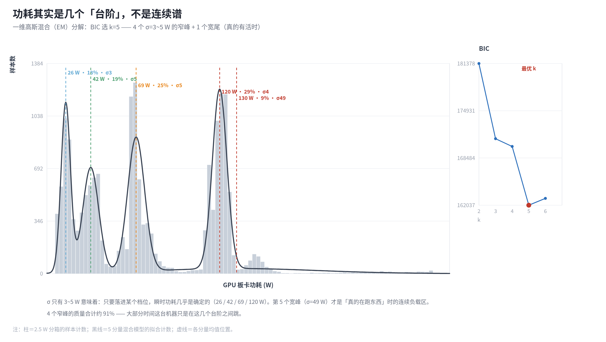

一维高斯混合（EM，BIC 选 k=5）：

| 分量 | 均值 | 权重 | σ | σ/μ |
|---|---|---|---|---|
| 1 | 26 W | 18% | 2.8 W | 11% |
| 2 | 42 W | 19% | 4.8 W | 12% |
| 3 | 69 W | 25% | 5.2 W | 7% |
| 4 | 120 W | 29% | 4.4 W | 4% |
| 5 | 130 W | 9% | 49.3 W | 38% |

前 4 个分量的 σ 只有 3–5 W（相对离散度 3–12%）：**功耗几乎是阶跃的**，对应电源管理在几个离散 V/f 点之间切换。第 5 个分量（σ=49 W）是「真的在跑东西」时的连续负载区。

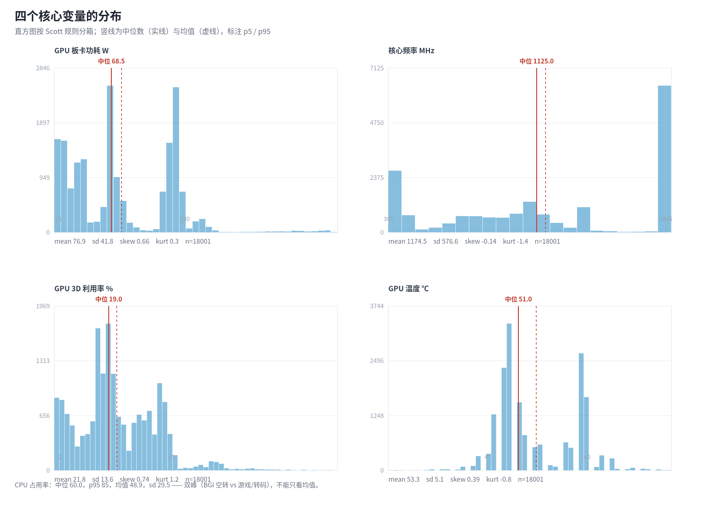

## 5. 功耗面与功率–频率律

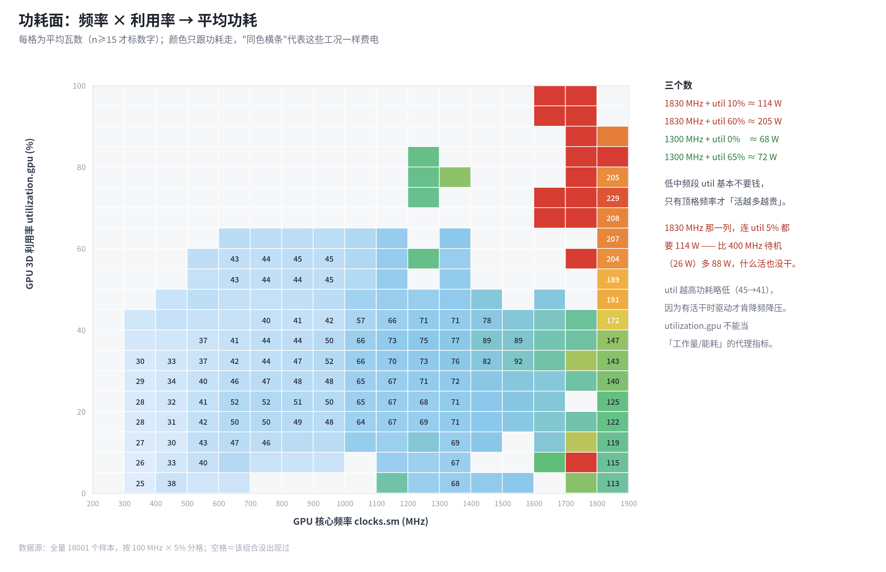

| 模型 | R² | 调整 R² | RMSE (W) | AIC |
|---|---|---|---|---|
| P ~ clk | 0.846 | 0.846 | 16.4 | 151806 |
| P ~ clk + util | 0.850 | 0.849 | 16.2 | 151353 |
| P ~ clk + util + clk·util | 0.907 | 0.907 | 12.7 | 142692 |
| P ~ clk + util + T | 0.924 | 0.924 | 11.5 | 139087 |

**频率的边际成本（含交互项模型，每 100 MHz）**：

| 利用率 | 每 100 MHz 的功耗增量 |
|---|---|
| 0% | 4.4 W |
| 10% | 5.8 W |
| 20% | 7.3 W |
| 40% | 10.2 W |
| 60% | 13.0 W |

这才是正确的读法：空载时抬频只付「静态/漏电」的钱（≈4.4 W/100 MHz），有活时还要付动态功耗（≈13 W/100 MHz）。所以「把空闲时的频率压下来」这件事的收益，比「在满载时省功耗」更干净。

分温度带的斜率（W/GHz）：

| 温度带 | n | 斜率 | 平均功耗 | 平均频率 |
|---|---|---|---|---|
| 0–50℃ | 4609 | 37.1 | 35 W | 560 MHz |
| 50–53℃ | 5695 | 42.5 | 56 W | 933 MHz |
| 53–56℃ | 1231 | 44.6 | 77 W | 1154 MHz |
| 56–60℃ | 3903 | 61.1 | 119 W | 1828 MHz |
| 60–101℃ | 2563 | 28.0 | 135 W | 1831 MHz |

除最热的 60 ℃+ 那一档（它被 250 W 的满载样本主导、已经饱和）之外，斜率随温度升高单调变大。但**不能全算成漏电**：高功耗本身会把温度推高（反向因果）。滞后相关显示温度与功耗的最佳对齐在 lag=0，也就是说在这个采样尺度上分不清先后 —— 想分辨需要更长的时间基线。

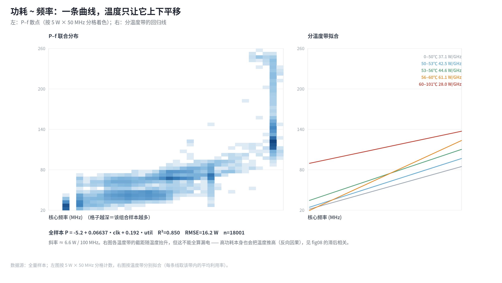

## 6. 工况状态（k-means，k=5）

在**工况空间**（log 频率、3D 利用率、CPU 占用——刻意不放功耗，避免用功耗解释功耗）里聚类。轮廓系数：k=2 最高（0.535），k=5 为 0.489；取 k=5 是因为它与一维 GMM 独立给出的档位数一致，可解释性远高于二分。

| 状态 | n | 时长 | 电量 | 电量占比 | 功耗 W | 频率 MHz | util | CPU | 温度 |
|---|---|---|---|---|---|---|---|---|---|
| S0 待机 | 3885 | 3.30 h | 101 Wh | 8.4% | 31±12 | 418 | 9.8% | 6.4% | 48.6 |
| S1 中载 | 7090 | 6.16 h | 385 Wh | 32.1% | 63±21 | 1036 | 30.5% | 65.9% | 51.0 |
| S2 中频满用 | 833 | 0.72 h | 75 Wh | 6.2% | 104±79 | 1184 | 51.4% | 56.0% | 55.3 |
| S3 满频空转 | 1191 | 1.03 h | 112 Wh | 9.3% | 109±15 | 1789 | 4.8% | 9.1% | 56.6 |
| S4 满频低载 | 5002 | 4.36 h | 527 Wh | 43.9% | 121±14 | 1810 | 18.1% | 66.0% | 59.2 |

状态抖动率（未平滑时短于 5 点的游程占比）：**18.6%** —— 驱动会在相邻 V/f 档之间高频跳变，所以统计前做了 3 点去抖（原始序列的中位驻留只有 3–6 s）。

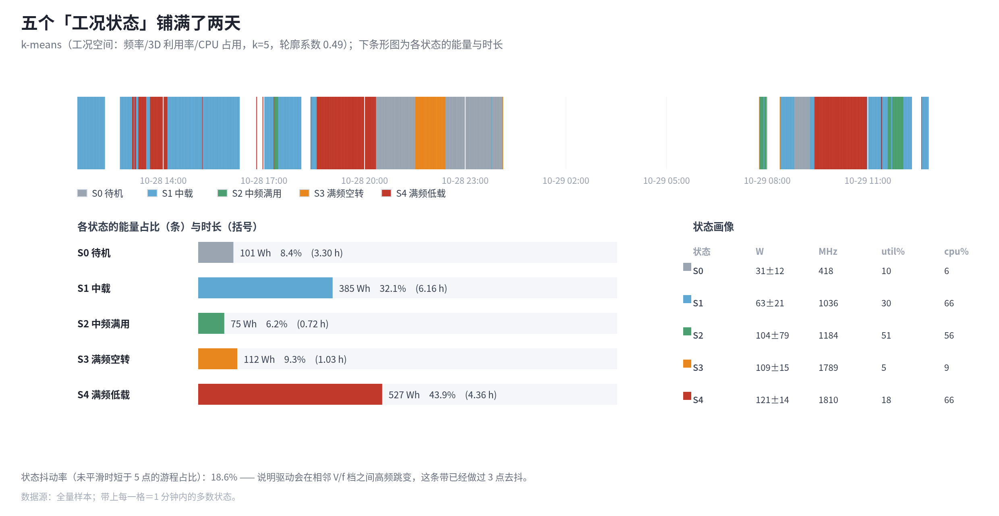

## 7. 状态动力学

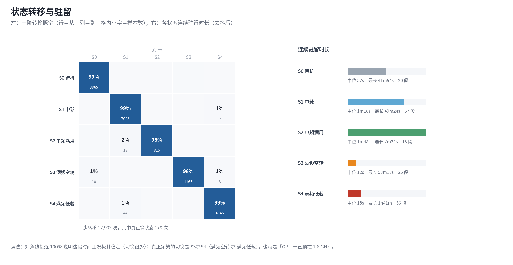

| 从 \ 到 | S0 | S1 | S2 | S3 | S4 |
|---|---|---|---|---|---|
| S0 待机 | 99% | 0% | 0% | 0% | 0% |
| S1 中载 | 0% | 99% | 0% | 0% | 1% |
| S2 中频满用 | 0% | 2% | 98% | 0% | 0% |
| S3 满频空转 | 1% | 0% | 0% | 98% | 1% |
| S4 满频低载 | 0% | 1% | 0% | 0% | 99% |

| 状态 | 段数 | 中位驻留 | 平均驻留 | 最长 |
|---|---|---|---|---|
| S0 待机 | 20 | 52s | 9m43s | 41m54s |
| S1 中载 | 67 | 1m18s | 5m17s | 49m24s |
| S2 中频满用 | 18 | 1m48s | 2m19s | 7m24s |
| S3 满频空转 | 25 | 12s | 2m23s | 53m18s |
| S4 满频低载 | 56 | 18s | 4m28s | 1h41m |

样本级的一步转移共 17,993 次，其中**真正换了状态的只有 179 次**（约每 5.2 分钟一次）—— 这段时间的工况极其稳定。非对角项几乎全部落在 S3⇄S4（满频空转 ⇄ 满频低载），也就是「GPU 一直顶在 1.8 GHz，只是偶尔来点活」。

## 8. 时间结构：自相关与有效样本量

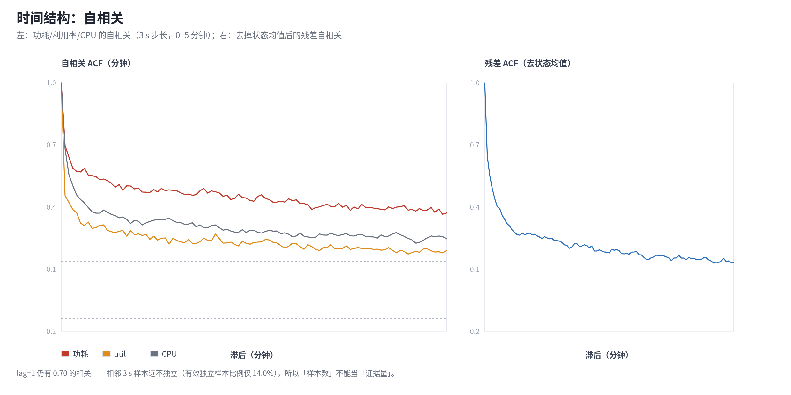

| 滞后 | 功耗 ACF | util ACF | CPU ACF |
|---|---|---|---|
| 3 s | 0.697 | 0.455 | 0.681 |
| 30 s | 0.532 | 0.313 | 0.371 |
| 60 s | 0.492 | 0.271 | 0.332 |
| 180 s | 0.431 | 0.225 | 0.257 |
| 300 s | 0.371 | 0.190 | 0.247 |

lag-1 相关 0.79，5 分钟时仍有 0.44，**有效独立样本比例只有 14.0%**。18001 个样本折算下来只相当于约 2513 个独立观测。做假设检验时必须用这个数，否则 p 值会小得离谱。

## 9. 变化点

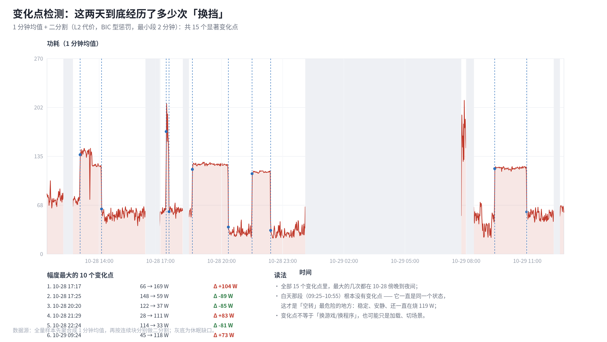

| # | 时间 | 前 2 分钟 | 后 2 分钟 | Δ |
|---|---|---|---|---|
| 1 | 10-28 17:17 | 66 W | 169 W | +104 W |
| 2 | 10-28 17:25 | 148 W | 59 W | -89 W |
| 3 | 10-28 20:20 | 122 W | 37 W | -85 W |
| 4 | 10-28 21:29 | 28 W | 111 W | +83 W |
| 5 | 10-28 22:24 | 114 W | 33 W | -81 W |
| 6 | 10-29 09:24 | 45 W | 118 W | +73 W |
| 7 | 10-29 10:58 | 120 W | 58 W | -61 W |
| 8 | 10-28 13:03 | 77 W | 137 W | +60 W |
| 9 | 10-28 14:07 | 122 W | 62 W | -59 W |
| 10 | 10-28 18:34 | 61 W | 117 W | +56 W |

共 15 个显著变化点（二分割，L2 代价 + BIC 型惩罚，最小段 2 分钟）。注意 09:25–10:55 那 90 分钟里**一个变化点都没有** —— 一直停在同一个状态，安静、稳定、持续烧着 ~119 W。

## 10. 能量核算

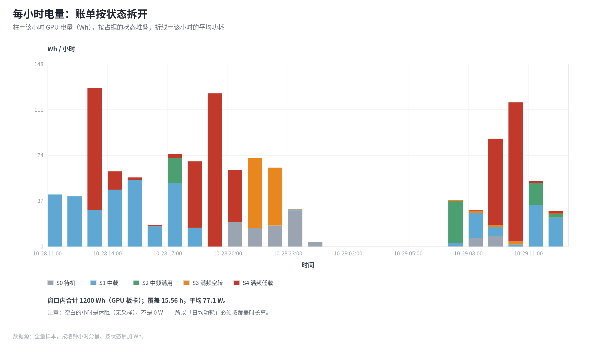

| 日期 | 覆盖时长 | GPU 电量 | 平均 |
|---|---|---|---|
| 2026-10-28 | 11.10 h | 842 Wh | 75.9 W |
| 2026-10-29 | 4.47 h | 358 Wh | 80.1 W |

电量最重的 8 个小时：

| 小时 | Wh 合计 | S0 Wh | S1 Wh | S2 Wh | S3 Wh | S4 Wh |
|---|---|---|---|---|---|---|
| 10-28 13:00 | 129 | 0 | 30 | 0 | 0 | 99 |
| 10-28 19:00 | 124 | 0 | 0 | 0 | 0 | 124 |
| 10-29 10:00 | 117 | 0 | 2 | 0 | 2 | 113 |
| 10-29 09:00 | 87 | 9 | 7 | 0 | 1 | 70 |
| 10-28 17:00 | 75 | 0 | 52 | 20 | 0 | 3 |
| 10-28 21:00 | 72 | 15 | 0 | 0 | 57 | 0 |
| 10-28 18:00 | 69 | 0 | 15 | 0 | 0 | 54 |
| 10-28 22:00 | 64 | 17 | 0 | 0 | 47 | 0 |

两天合计 **1200 Wh**；若只算 S3+S4（满频）则是 **639 Wh（53%）**，只花在 5.39 h 上。反过来说：如果把满频段（实测均值 121 W）整体压到 1350 MHz 一档（实测 ≈70 W），在这 5.39 h 上大约能省 **262 Wh**。注意这是「等速」外推——真降频后同样的活要跑更久，实际收益会打折扣，量级参考即可。

## 11. 温度

温度：中位 51 ℃、p95 60 ℃、最高 71 ℃，sd 5.1；与功耗的相关性 0.931，与频率 0.868。

按状态看稳态温度：S0 49℃、S1 51℃、S2 55℃、S3 57℃、S4 59℃。

滞后相关（功耗 vs 温度，±2 分钟窗口）的峰值在 lag=0：这个采样尺度上两者同步，分不出因果方向。真要分离漏电，得在恒功率下改变风扇/环境温度，或者用更长的停机-升温曲线。

## 12. 你能分辨多大的差异？（功效分析）

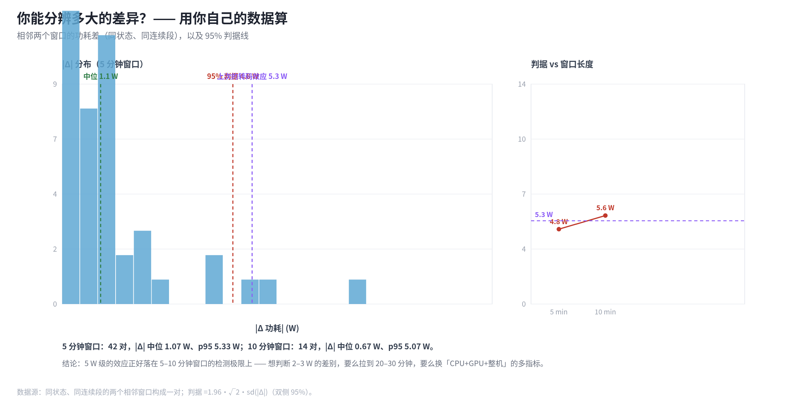

| 窗口 | 对数 | |Δ| 中位 | |Δ| p95 | 95% 判据 |
|---|---|---|---|---|
| 5 min | 42 | 1.07 W | 5.33 W | 4.76 W |
| 10 min | 14 | 0.67 W | 5.07 W | 5.63 W |

做法：在同一连续段、同一状态内，把时间切成相邻的等长窗口，统计「两窗均值之差」。这是对你自己的数据做的**实测**噪声底，比任何理论假设都靠谱。

结论：5 分钟窗口的判据 ≈ 4.8 W，10 分钟 ≈ 5.6 W。上一轮测到的 **−5.3 W** 正好骑在这条线上——它显著（SE 0.8 W），但离「能放心下结论」只差一点。要判断 2–3 W 级别的差异，得拉到 20–30 分钟，或者换多指标（CPU+GPU+整机）联合判断。

## 13. 采样质量

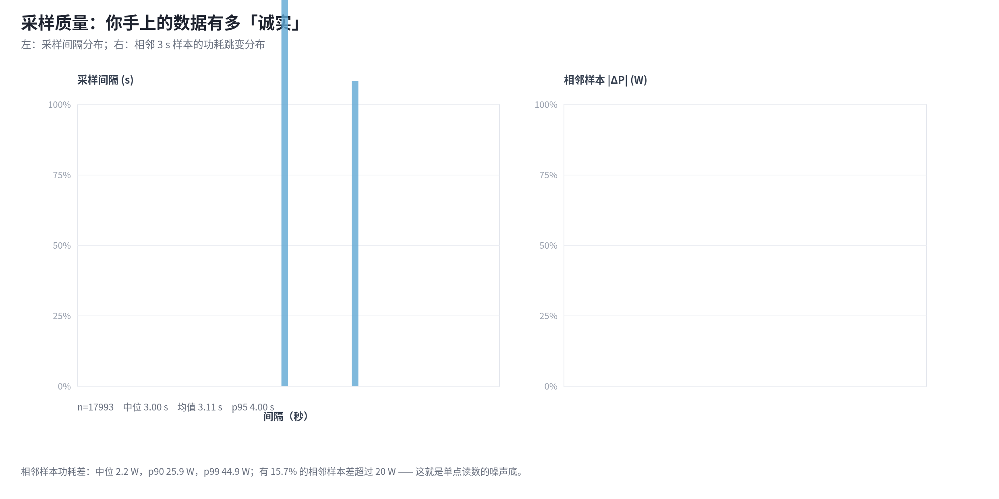

间隔中位 3.00 s、抖动（sd）0.311 s。采样由 3 s 的 Timer + 每次 spawn 一个 `nvidia-smi` 进程实现，进程启动的耗时被算进了间隔，所以会出现 3.0 / 4.0 s 两簇。

## 14. 缺失的统计（重要）

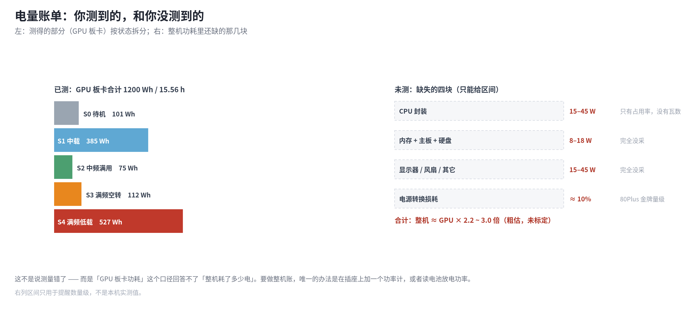

| 缺口 | 影响 | 补法 |
|---|---|---|
| CPU 瓦数 | 只有占用率；而且工具自己会用 `powercfg` 限频，跨预设比 CPU% 不成立 | PDH `\Power Meter(*)\Power` / LibreHardwareMonitor |
| `utilization.encoder/decoder` | 无法判断转码是否走 GPU | 加进 nvidia-smi query |
| `clocks.mem` | 600–1000 MHz 那段 45 W 的「地板」无法解释 | 同上 |
| `power.limit` / `pstate` / throttle reason | 分不清「被限」还是「没活」 | 同上 |
| 整机功率 | GPU 板卡 ≠ 墙插 | 插座功率计 / 电池放电率 |
| 进程归因 | 不知道谁在吃 GPU | PDH `\GPU Engine(*)\Utilization Percentage` |
| `power.draw` 是瞬时值 | 与 3 s 平均不等价 | 用 `power.draw.average`（1 s 窗）或 NVML |

## 15. 事件对齐

日志里共 62 条模式事件，但**落在数据窗口内、且两侧都有数据的只有 2 条**（都在 10-28 11:26 工具启动那一刻）。也就是说这 25 小时里**没有发生过一次预设切换** —— 工具是「设完就不管」的状态，所有观察都是 game 预设（250 W 上限、`-rgc`）下的行为。

| 时间 | 事件 | 前 10 分钟均值 | 后 10 分钟均值 |
|---|---|---|---|
| 10-28 11:26:25 | work | — | 79 W |
| 10-28 11:26:36 | game | — | 79 W |
| 10-28 12:14:29 | sleep | 78 W | — |
| 10-28 12:42:51 | wake | — | 75 W |
| 10-28 16:16:07 | sleep | 59 W | — |
| 10-28 16:58:05 | wake | — | 57 W |
| 10-28 18:06:04 | sleep | 60 W | — |
| 10-28 18:24:10 | wake | — | 58 W |
| 10-29 00:06:25 | sleep | 34 W | — |
| 10-29 07:45:36 | wake | — | 162 W |
| 10-29 07:59:40 | sleep | 170 W | — |
| 10-29 08:23:01 | wake | — | 52 W |
| 10-29 12:17:45 | sleep | 55 W | — |
| 10-29 12:35:55 | wake | — | 64 W |

（`sleep` 的「后」为空、`wake` 的「前」为空，是缺口本身造成的，正常。）

## 16. 结论与行动清单

1. **最贵的是「满频低载」**：S3+S4 占了 53% 的电量，其中真正在跑活的只有极少数时间。把 `-lgc` 上限收到 1350 MHz 是唯一高杠杆的动作，`-pl` 几乎没用（250 W 只在 07:45–08:00 摸到过）。
2. **不要用 `utilization.gpu` 当功耗代理**：1830 MHz 时 util 4% 也要 110 W；1300 MHz 时 util 从 0 到 65% 只差 4 W。
3. **采样机制要升级**：3 s + 每次 spawn nvidia-smi 既慢又有观测者效应；换 NVML 可以在 1 Hz 甚至 4 Hz 无成本采样。
4. **样本量 ≠ 证据量**：有效独立样本只有 14%，任何 5 W 级的结论都需要 ≥10 分钟窗口 + 配对设计。
5. **补齐四列就能回答上一轮的问题**（CPU 瓦数 / encoder / clocks.mem / power.limit），成本一行 query。

---

### 附：产物清单

| 文件 | 内容 |
|---|---|
| `out/report.md` | 本文 |
| `out/dashboard.html` | 单文件看板（内嵌全部 SVG + 表格），离线可开 |
| `out/charts/fig01…fig14.png/.svg` | 14 张图 |
| `out/tables/*.csv` | minute / hour / state / changepoints / summary / windows / gaps / events |
| `gta.py` | 数据层 + 统计原语（无副作用，可复用） |
| `pipeline.py` | 统计管线 |
| `figures.py` / `charts.py` | 图 |
| `build.py` | 一键重建 |